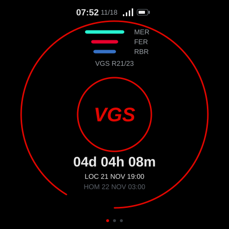
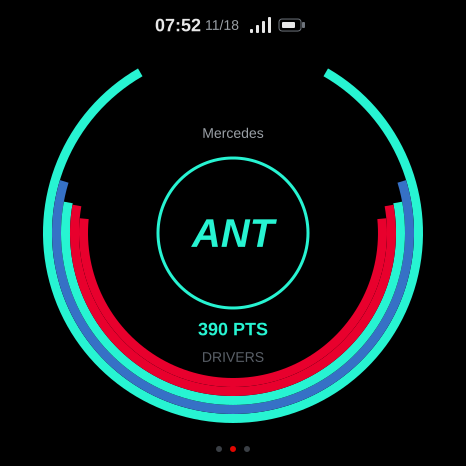
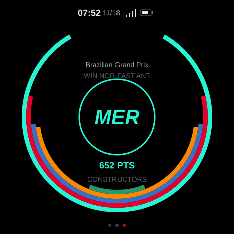
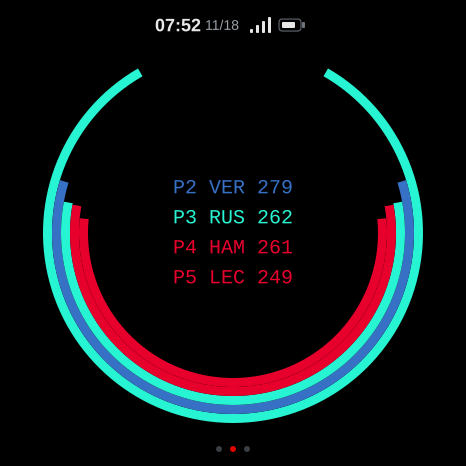
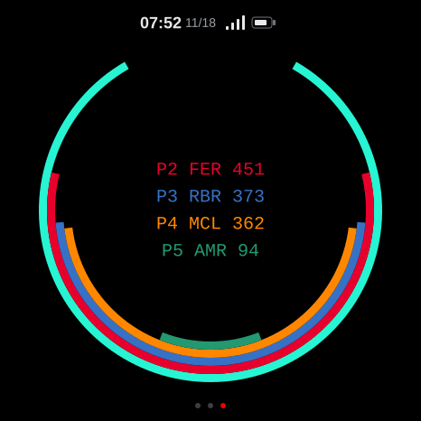

# F1 Dashboard — ESP32-S3 Touch AMOLED 1.75"

A Formula 1 telemetry dial for the [Waveshare ESP32-S3-Touch-AMOLED-1.75C](https://www.waveshare.com/esp32-s3-touch-amoled-1.75.htm)
(466 × 466 round AMOLED, capacitive touch, 32 MB flash, 8 MB PSRAM).

It pulls live championship data from the free [Jolpica-F1](https://github.com/jolpica/jolpica-f1)
API (Ergast successor, no API key needed) and renders three F1-styled watch faces
with an always-on status strip (clock, date, Wi-Fi signal, battery).

> Not affiliated with Formula 1. F1, FORMULA 1 and related marks are trade marks
> of Formula One Licensing BV. Data is provided by third parties, for
> informational purposes only.

## Features

- **Page 1 — Next session dial**
  - Circuit code, round (e.g. `LOS R22/23`), season-progress arc
  - Countdown to the **nearest upcoming session** — it walks through
    `FP1 → FP2 → FP3 → SQ → SPR → Q → RACE` automatically as the weekend progresses
  - Session start time in **circuit local time** (`LOC`) and in your timezone
    (`HOM`, default UTC+8), including DST where applicable
  - Top-3 constructor points bars
- **Page 2 — Drivers' championship**
  - Leader badge in the constructor's team colour, points, team name
  - Tap the centre to expand P2–P5 with points (each row in its team colour)
- **Page 3 — Constructors' championship**
  - Leader badge in team colour, last race, winner and fastest lap
  - Tap the centre to expand P2–P5
- **Status strip** — clock (SNTP-synced, UTC+8), date, 4-bar Wi-Fi indicator,
  battery level/charging icon (read from the on-board AXP2101 PMU)
- **AMOLED care** — pure-black background, blanking after 20 s idle, tap to wake,
  ±1° arc drift against burn-in

## Screenshots

Three watch faces — tap the left/right third of the screen to switch. On pages 2
and 3, tap the centre badge to expand the P2–P5 list (right column). These
diagrams are rendered from the exact geometry and palette in `main/ui.c` (see
`tools/render_screenshots.py`), not photos, so they stay crisp and versioned
with the firmware.

| Page 1 · Next session | Page 2 · Drivers | Page 3 · Constructors |
|:---:|:---:|:---:|
|  |  |  |

| Page 2 · P2–P5 (tapped) | Page 3 · P2–P5 (tapped) |
|:---:|:---:|
|  |  |

## Hardware

| | |
|---|---|
| Board | Waveshare ESP32-S3-Touch-AMOLED-1.75C (ESP32-S3R8, 32 MB flash) |
| Display | 1.75" 466×466 AMOLED, CO5300 QSPI driver |
| Touch | CST9217, I²C |
| Power mgmt | AXP2101 (battery gauge over I²C) |

A battery is optional — the icon falls back to a dim "no pack" state when the
gauge reports no battery.

## Getting started

### 1. Prerequisites

- [ESP-IDF](https://docs.espressif.com/projects/esp-idf/en/v5.5/esp32s3/get-started/index.html) **v5.5.x** (v5.5.6 was used for development)
- USB-C **data** cable (the board exposes a native USB Serial/JTAG port, driver-free on Win10/11)

### 2. Build and flash

```bash
git clone <this repo>
cd f1-dashboard
idf.py set-target esp32s3
idf.py build
idf.py -p COM5 flash monitor      # replace COM5 with your port
```

The component manager downloads the remaining dependencies automatically
(`managed_components/`); the Waveshare BSP is **vendored** into
`components/waveshare_esp32_s3_touch_amoled_1_75c/` because this fork carries
small display patches (see [Patches](#patches)).

<details>
<summary>Windows without the IDF shell (optional helper)</summary>

`tools/idf_runner.py` runs `idf.py` from a plain Git-Bash shell by loading
`idf.main()` directly (works around the `MSYSTEM` guard) and pins the toolchain
paths. `tools/serial_read.py` is a small DTR/RTS-safe serial logger used during
development.

```bash
python tools/idf_runner.py -p COM5 flash
python tools/serial_read.py COM5 30        # 30 s of logs, no reset
python tools/serial_read.py COM5 30 reset  # reset, then 30 s of logs
```
</details>

### 3. Wi-Fi setup

On first boot — or whenever the stored network is unavailable — the device opens
a captive setup AP:

1. Join the **`F1-DASH`** Wi-Fi network (open, no password)
2. Open `http://192.168.4.1`
3. Enter your SSID + password → the device saves it (NVS), reboots and reconnects
4. Reconnection is automatic; the fetch task also re-kicks association every ~15 s
   if the link drops

## Usage

| Action | Result |
|---|---|
| Tap **left / right third** of the screen | Previous / next page |
| Tap **centre badge** (page 2 & 3) | Toggle leader view ⇄ P2–P5 list |
| **Long-press** anywhere on page 2 / 3 | Force a data refresh |
| Idle 20 s | Screen off (AMOLED burn-in protection) |
| Touch | Wake up |

Data refreshes every 5 minutes; a failed request never blanks the screen — the
last good values are kept until the next successful fetch.

## Data source

All standings, calendars and results come from the
[Jolpica-F1 API](https://github.com/jolpica/jolpica-f1)
(`https://api.jolpi.ca/ergast/f1/...`), a free and open Ergast-compatible
service. No API key is required; please be nice to it — the default poll rate is
one full refresh every 5 minutes.

Session times are published in UTC; the dial converts them with per-circuit
POSIX `TZ` rules (see `circuit_tz()` in `main/f1_api.c`), so circuit-local times
include daylight saving.

## Project layout

```
main/
  main.c        app entry, Wi-Fi + fetch task
  f1_api.c/.h   Wi-Fi provisioning, Jolpica-F1 client, calendar/session parser
  ui.c/.h       three pages, status strip, leader/list toggle
  status.c/.h   AXP2101 battery, SNTP clock, Wi-Fi RSSI
  fonts/        Titillium Web glyphs generated with lv_font_conv
components/
  waveshare_esp32_s3_touch_amoled_1_75c/   vendored BSP (patched, Apache-2.0)
docs/
  images/*.svg        the three faces, rendered from ui.c (see Screenshots)
tools/
  render_screenshots.py  regenerate docs/images/*.svg from the UI rules
  idf_runner.py          idf.py wrapper for plain Git-Bash on Windows
  serial_read.py         DTR/RTS-safe serial logger
```

### Patches

The vendored BSP differs from upstream
([Waveshare-ESP32-components](https://github.com/waveshareteam/Waveshare-ESP32-components),
`bsp/esp32_s3_touch_amoled_1_75c`, v3.0.0) in two places, both required to keep
the display stable when Wi-Fi + TLS are running:

1. `esp32_s3_touch_amoled_1_75c.c` → `buffer_height = 50` **→ `16`**.
   Every LVGL flush is copied into a transient internal-RAM DMA buffer; with the
   Wi-Fi + mbedTLS footprint only ~30 KB of DMA-capable RAM stays free, and a
   50-row buffer (46 KB per flush) cannot be allocated → white screen.
2. Same file → `rounder_event_cb` now expands every flush to **full scanlines**
   instead of rounding to even pixels. Narrow partial windows produced speckle
   right above text on this panel.

If you update the BSP, re-apply those two changes.

## Troubleshooting

| Symptom | Cause / fix |
|---|---|
| White screen at boot | Internal DMA RAM exhausted — keep `CONFIG_BSP_LCD_TRANS_QUEUE_DEPTH=1` and the 16-row draw buffer |
| Speckle above text | Narrow partial windows on this panel — the vendored rounder already forces full-width flushes |
| `mbedtls_ssl_setup` fails (-0x7F00) | TLS buffers must come from PSRAM: `CONFIG_MBEDTLS_EXTERNAL_MEM_ALLOC=y` |
| Wi-Fi never connects | Erase NVS (`idf.py -p PORT erase-flash`) and re-provision |
| Blank page after switching | Fixed by `lv_obj_invalidate()` on page entry; make sure you run the latest commit |

## Acknowledgements

- [Waveshare](https://www.waveshare.com/) — ESP32-S3-Touch-AMOLED-1.75C BSP
  (vendored under `components/`, Apache-2.0, modified as described above)
- [Espressif](https://www.espressif.com/) — ESP-IDF, `esp_lvgl_adapter`,
  `esp_lcd_co5300`, `esp_lcd_touch_cst9217` and other managed components
- [LVGL](https://lvgl.io/) — UI toolkit (MIT)
- [Jolpica-F1](https://github.com/jolpica/jolpica-f1) — open Ergast-compatible
  F1 data API
- [Titillium Web](https://fonts.google.com/specimen/Titillium+Web) — the F1-style
  typeface used for all glyphs (SIL Open Font License)

## License

This project's own code is released under the [MIT License](LICENSE).

Third-party components keep their own licenses: the vendored Waveshare BSP and
Espressif components are Apache-2.0, LVGL is MIT, the Titillium Web font is
SIL-OFL. Their license files are distributed alongside the sources.

---

## 简体中文说明

给微雪 ESP32-S3-Touch-AMOLED-1.75C（1.75 寸 466×466 圆形 AMOLED）做的 F1 赛事表盘。
三页实拍示意图见上方 [Screenshots](#screenshots) 章节。

- **第 1 页**：下一站赛道、赛季进度弧、倒计时（自动跟随 FP1→FP2→FP3→排位→冲刺→正赛，
  显示赛道当地时间和北京时间双行）
- **第 2 页**：车手积分榜领跑者（车队配色），点中心展开 2–5 名
- **第 3 页**：车队积分榜领跑者 + 上一站冠军/最快圈，点中心展开 2–5 名
- **状态栏**：时间/日期/Wi-Fi 信号/电池电量（AXP2101 实时读取）

首次开机连接 `F1-DASH` 热点，浏览器打开 `http://192.168.4.1` 配网。
数据来自免费的 Jolpica-F1 接口，每 5 分钟刷新一次；20 秒无操作自动息屏，点屏幕唤醒。

编译烧录同上文，需要 ESP-IDF v5.5.x。
